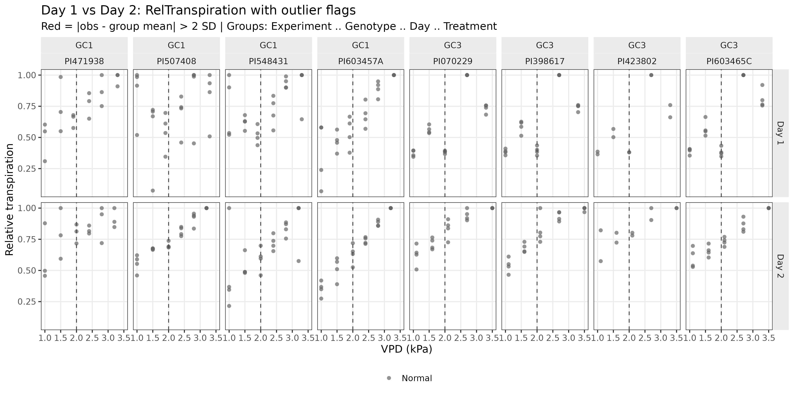
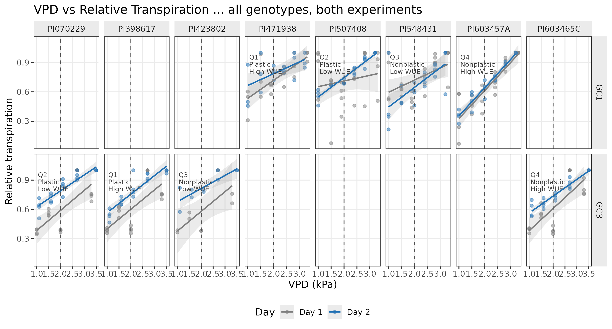
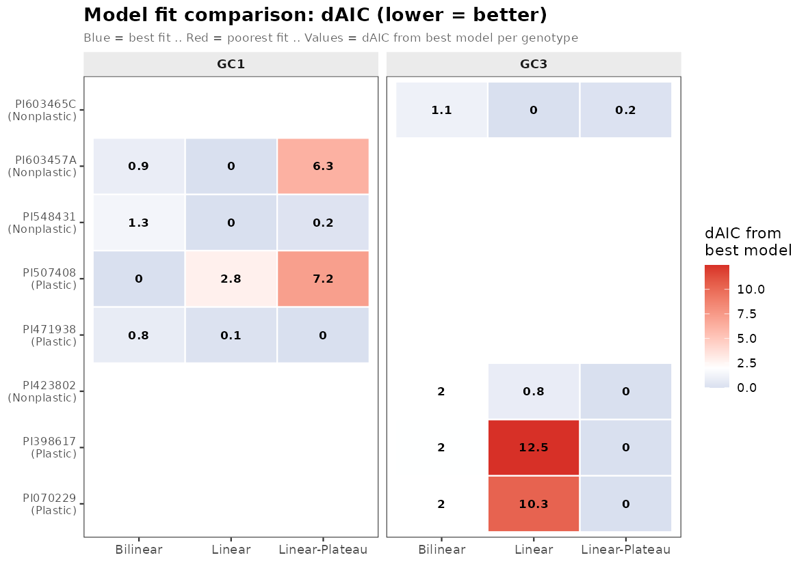
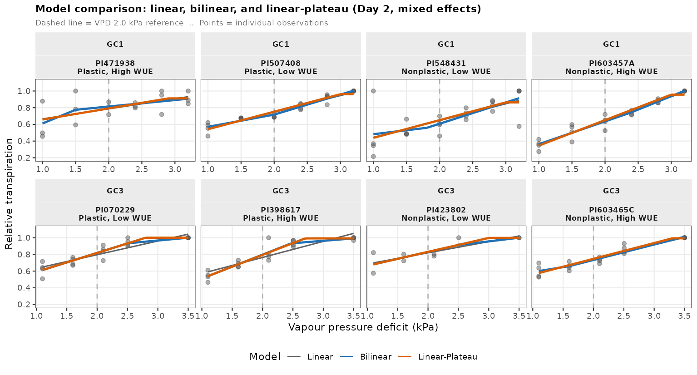
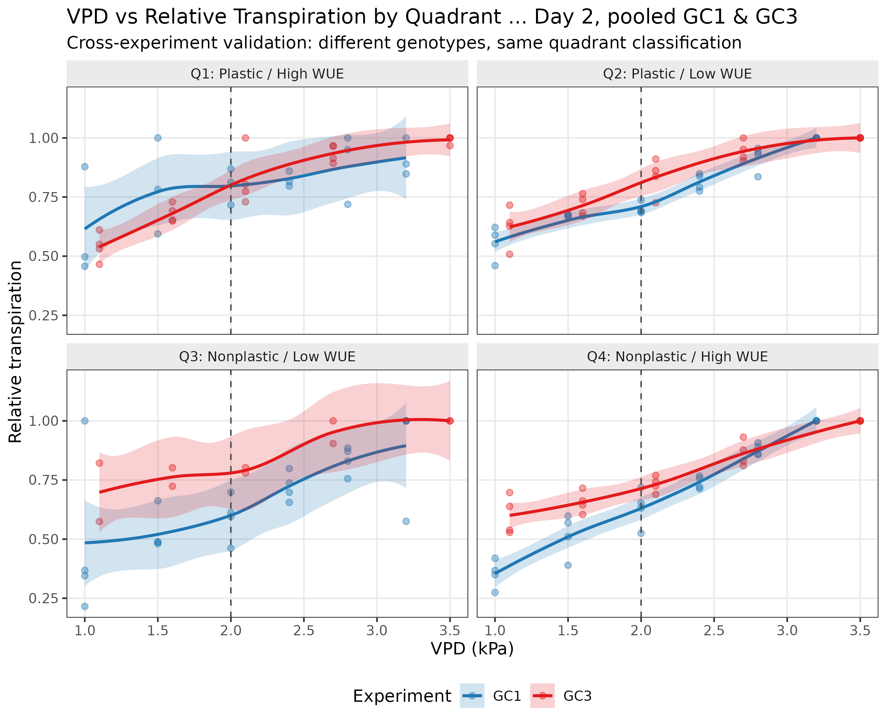
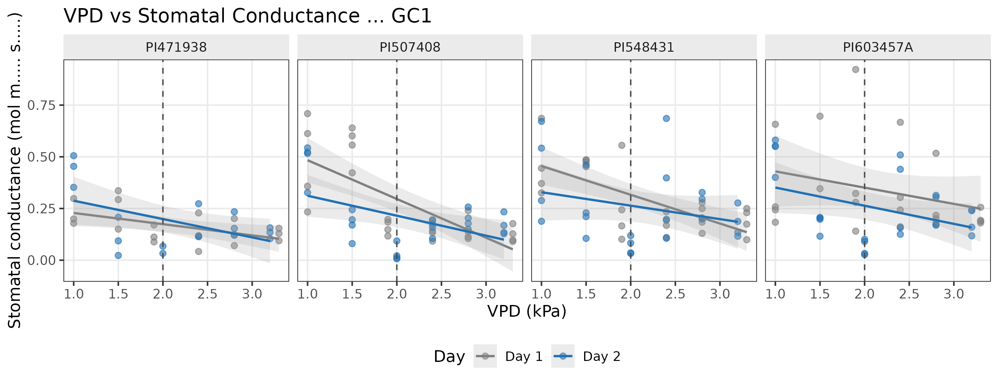
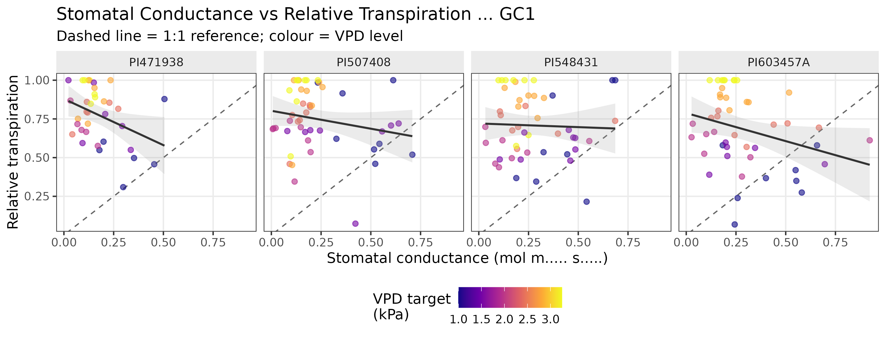
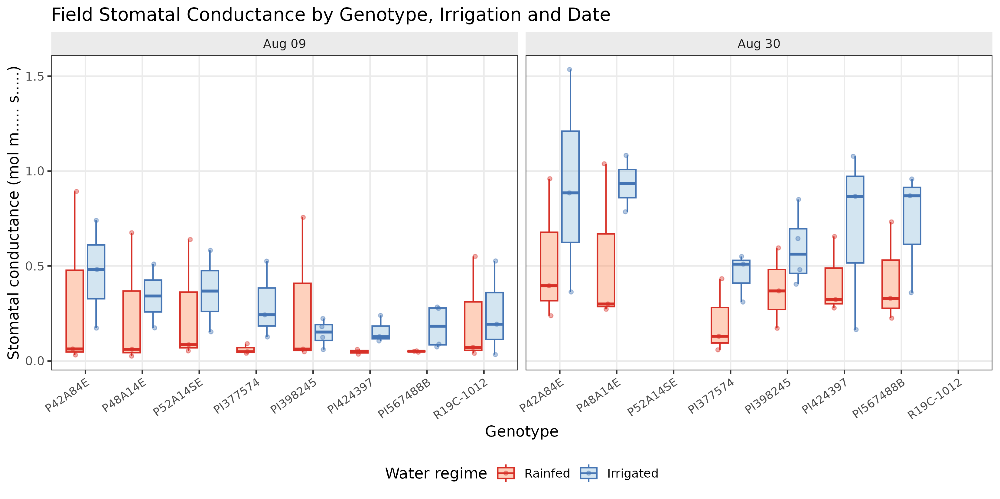
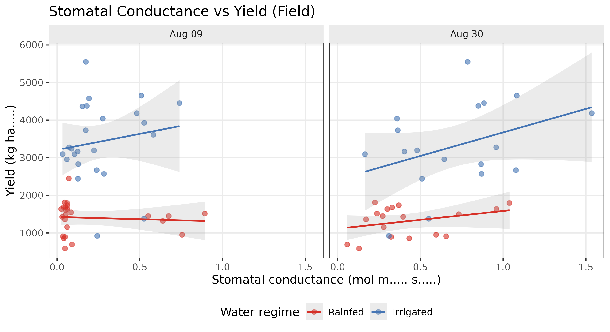

```{r setup, include=FALSE}
knitr::opts_chunk$set(echo = FALSE, warning = FALSE, message = FALSE)
knitr::opts_knit$set(root.dir = "/home/user/LT-trait/experimental_data")
```

```{r libraries}
library(knitr)
library(kableExtra)
library(dplyr)
```

# Project Overview

This report summarizes the growth chamber (GC) transpiration experiments conducted as part of a 2024–2026 Research Incentive Grant (RIG) project at the University of Missouri. The study evaluates how soybean accessions differ in their transpiration response to increasing vapor pressure deficit (VPD), framing the analysis within the Chamarthi et al. (2022) water-use efficiency (WUE) plasticity quadrant framework.

The core hypothesis is that Q1 genotypes (Plastic, High WUE) exhibit a limited-transpiration (LT) response — a plateau in relative transpiration at high VPD — while Q4 genotypes (Nonplastic, High WUE) maintain a linear transpiration response. Identifying genotypes with this LT trait has direct implications for breeding water-efficient soybean for drought-prone environments.

Three growth chamber experiments (GC1, GC2, GC3) were conducted across 2024–2025, each using a different set of four soybean accessions representing the four WUE quadrants. Field stomatal conductance (SC) and yield data were also collected in summer 2024.

# Experimental Design

```{r design-table}
design <- data.frame(
  Experiment = c("GC1", "GC1", "GC1", "GC1",
                 "GC2", "GC2", "GC2", "GC2",
                 "GC3", "GC3", "GC3", "GC3"),
  Genotype   = c("PI471938", "PI507408", "PI548431", "PI603457A",
                 "PI398245", "PI567488B", "PI377574", "PI424397",
                 "PI398617", "PI070229", "PI423802", "PI603465C"),
  Quadrant   = c("Q1", "Q2", "Q3", "Q4",
                 "Q1", "Q2", "Q3", "Q4",
                 "Q1", "Q2", "Q3", "Q4"),
  WUE_class  = c("Plastic, High", "Plastic, Low", "Nonplastic, Low", "Nonplastic, High",
                 "Plastic, High", "Plastic, Low", "Nonplastic, Low", "Nonplastic, High",
                 "Plastic, High", "Plastic, Low", "Nonplastic, Low", "Nonplastic, High"),
  VPD_levels = c("1.0, 1.5, 1.9, 2.4, 2.8, 3.3 kPa",
                 "1.0, 1.5, 1.9, 2.4, 2.8, 3.3 kPa",
                 "1.0, 1.5, 1.9, 2.4, 2.8, 3.3 kPa",
                 "1.0, 1.5, 1.9, 2.4, 2.8, 3.3 kPa",
                 "Pending",
                 "Pending",
                 "Pending",
                 "Pending",
                 "1.0, 1.5, 2.0, 2.7, 3.3 kPa",
                 "1.0, 1.5, 2.0, 2.7, 3.3 kPa",
                 "1.0, 1.5, 2.0, 2.7, 3.3 kPa",
                 "1.0, 1.5, 2.0, 2.7, 3.3 kPa"),
  SC_data = c("Yes", "Yes", "Yes", "Yes",
              "No", "No", "No", "No",
              "No", "No", "No", "No")
)

kable(design, caption = "Soybean genotypes, WUE quadrant classification, and experimental design across GC experiments.") %>%
  kable_styling(bootstrap_options = c("striped", "hover", "condensed"), full_width = FALSE) %>%
  pack_rows("GC Experiment 1", 1, 4) %>%
  pack_rows("GC Experiment 2", 5, 8) %>%
  pack_rows("GC Experiment 3", 9, 12)
```

**Relative transpiration** is the primary response variable, calculated as transpiration rate at each VPD treatment divided by the rate at the lowest VPD (T1 = 1.0 kPa). A value of 1.0 at high VPD indicates a proportional response (no LT trait); a plateau below 1.0 at high VPD indicates limited transpiration.

# Data Quality Control

## Day 1 vs Day 2 comparison

Plants were measured on two consecutive days under each VPD treatment. Day 1 shows a systematic acclimation artifact — higher variability and lower mean transpiration — consistent with stomatal adjustment to the new chamber conditions. Day 2 measurements are more stable and are used for all modelling.

```{r day1-vs-day2, fig.cap="Day 1 vs Day 2 comparison of relative transpiration across genotypes and VPD treatments.", out.width="100%"}
if (file.exists("figures/GC_Fig_diag_Day1vsDay2.png")) {
  
}
```

## Coefficient of Variation by Day and Experiment

```{r cv-table}
gc <- tryCatch(read.csv("cleaned_data/GC_combined_clean.csv", stringsAsFactors = FALSE),
               error = function(e) NULL)

if (!is.null(gc)) {
  cv_tab <- gc %>%
    mutate(Day = as.character(Day)) %>%
    group_by(Experiment, Day) %>%
    summarise(
      N        = n(),
      Mean_RelT = round(mean(RelTranspiration, na.rm = TRUE), 3),
      SD_RelT   = round(sd(RelTranspiration, na.rm = TRUE), 3),
      CV        = round(sd(RelTranspiration, na.rm = TRUE) / mean(RelTranspiration, na.rm = TRUE), 3),
      .groups   = "drop"
    )
  kable(cv_tab,
        col.names = c("Experiment", "Day", "N", "Mean RelTransp", "SD", "CV"),
        caption = "Coefficient of variation (CV) of relative transpiration by Day and Experiment. Day 2 shows consistently lower CV.") %>%
    kable_styling(bootstrap_options = c("striped", "hover"), full_width = FALSE) %>%
    column_spec(6, bold = TRUE,
                color = ifelse(cv_tab$CV > 0.30, "red", "black"))
} else {
  cat("GC_combined_clean.csv not found — skipping CV table.")
}
```

## Outlier detection

Outlier screening was performed by computing standardized residuals (z-scores) within each Experiment × Genotype × Day × Treatment group. No observations exceeded ±2 SD from the group mean. All 320 observations were retained in the cleaned dataset.

## Conclusion: use Day 2 only

Based on the CV analysis and visual inspection (figure above), **Day 2 is used exclusively** for all subsequent modelling and statistical comparisons.

# VPD vs Relative Transpiration — All Genotypes

```{r main-allgeno, fig.cap="Relative transpiration vs VPD for all genotypes (Day 2, GC1 and GC3 combined). Points are individual pot measurements; lines are loess smooths. Q1 genotypes (orange) show a plateau at high VPD; Q4 genotypes (blue) maintain a linear response.", out.width="100%"}
if (file.exists("figures/GC_Fig_main_allgeno.png")) {
  
}
```

# Model Fitting Results

## Model descriptions

Three mixed-effects model forms were fitted per genotype using the `lme4` package with replication as a random intercept (`(1|Replication)`) and REML = FALSE (for AIC comparison):

- **Linear**: `RelTranspiration ~ VPD` — assumes proportional increase with VPD across the full range.
- **Bilinear**: two-segment piecewise linear model; breakpoint estimated via the `segmented` package using profile likelihood.
- **Linear-Plateau (LP)**: linear increase up to a breakpoint (BP), then a flat plateau. BP selected by AIC grid search over the observed VPD range.

The best model was selected by lowest AIC. ΔAIC < 2 indicates models are statistically indistinguishable.

## Model comparison table

```{r model-table}
mc <- tryCatch(read.csv("stats/GC_model_comparison.csv", stringsAsFactors = FALSE),
               error = function(e) NULL)

if (!is.null(mc)) {
  display_cols <- c("Experiment", "Genotype", "Best_model", "dAIC_best",
                    "Lin_AIC", "Bilin_AIC", "LP_AIC",
                    "LP_BP", "Lin_R2", "LP_R2")
  mc_disp <- mc[, intersect(display_cols, colnames(mc))]
  mc_disp <- mc_disp %>%
    mutate(across(where(is.numeric), ~ round(.x, 3)))

  model_colors <- case_when(
    mc_disp$Best_model == "Linear"          ~ "#4e9a46",
    mc_disp$Best_model == "Bilinear"        ~ "#d95f02",
    mc_disp$Best_model == "Linear-Plateau"  ~ "#1f78b4",
    TRUE                                    ~ "black"
  )

  kable(mc_disp,
        caption = "AIC-based model comparison for each genotype. Best_model column is colour-coded by model type: green = Linear, orange = Bilinear, blue = Linear-Plateau.") %>%
    kable_styling(bootstrap_options = c("striped", "hover", "condensed"), full_width = TRUE) %>%
    column_spec(which(colnames(mc_disp) == "Best_model"),
                bold = TRUE, color = model_colors)
} else {
  cat("GC_model_comparison.csv not found.")
}
```

## AIC heatmap

```{r aic-heatmap, fig.cap="AIC heatmap comparing model performance across genotypes and experiments. Lighter colours indicate lower (better) AIC.", out.width="100%"}
if (file.exists("figures/GC_Fig_AIC_heatmap.png")) {
  
}
```

## Fitted curves

```{r model-fits, fig.cap="Best-fit model curves overlaid on Day 2 data for each genotype. Dashed vertical lines indicate estimated breakpoints for Bilinear and Linear-Plateau models.", out.width="100%"}
if (file.exists("figures/GC_Fig_model_fits.png")) {
  
}
```

## Interpretation

- **Q1 genotypes** (PI471938, PI398617): Linear-Plateau model fits best, with breakpoints at ~2.4–2.9 kPa. This confirms the limited-transpiration (LT) trait — transpiration plateaus at moderate-to-high VPD.
- **Q4 genotypes** (PI603457A, PI603465C): Linear model fits best (R² > 0.91), with no detectable VPD threshold. These genotypes maintain proportional transpiration increases across the full VPD range tested.
- **Q2/Q3 genotypes**: Intermediate responses; ΔAIC < 2 in most cases, indicating that additional replication (n ≥ 6 per treatment) and wider VPD range (up to 3.5–4.0 kPa) are needed to discriminate model forms with confidence.

# WUE Quadrant Analysis

```{r quadrant-pooled, fig.cap="Relative transpiration pooled by WUE quadrant (Day 2, GC1 + GC3). Q1 (Plastic, High WUE) shows the strongest plateau response; Q4 (Nonplastic, High WUE) shows the most linear response.", out.width="100%"}
if (file.exists("figures/GC_Fig_quadrant_pooled.png")) {
  
}
```

# Stomatal Conductance (GC1)

Stomatal conductance (SC, mmol m⁻² s⁻¹) was measured concurrently with transpiration in GC1 using the LI-600 porometer. This allows direct assessment of the stomatal mechanism underlying the LT trait.

```{r sc-vpd, fig.cap="Stomatal conductance vs VPD for GC1 genotypes (Day 2). Q1 genotype (PI471938) shows decreasing SC at high VPD, consistent with stomatal closure driving the LT response.", out.width="100%"}
if (file.exists("figures/GC_Fig_SC_vs_VPD.png")) {
  
}
```

```{r sc-transp, fig.cap="Stomatal conductance vs relative transpiration for GC1 genotypes. The positive relationship confirms SC as the primary driver of transpiration variation.", out.width="100%"}
if (file.exists("figures/GC_Fig_SC_vs_Transp.png")) {
  
}
```

# Field Stomatal Conductance & Yield

Field measurements were conducted at two dates (August 9 and August 30, 2024) under rainfed and irrigated conditions, capturing SC alongside wilting scores and end-of-season yield data.

```{r field-overview, fig.cap="Field experiment overview: stomatal conductance, wilting score, and yield by genotype and water management treatment (Rainfed vs Irrigated).", out.width="100%"}
if (file.exists("figures/SC_field_Fig_overview.png")) {
  
}
```

```{r field-sc-yield, fig.cap="Field stomatal conductance vs yield by genotype and water management. Higher SC under rainfed conditions in Q1 genotypes may reflect improved water-use strategy.", out.width="100%"}
if (file.exists("figures/SC_field_Fig_SC_vs_Yield.png")) {
  
}
```

# Data Quality Audit Findings

A systematic audit of all Excel source files (GC1 `Data_analysis.xlsx`, GC2 `GC_experiment_2.xlsx`, GC3 `GC_experiment_3.xlsx`) was completed after initial data processing. Key findings and corrections applied to `GC_combined_clean.csv` are documented below.

## Critical Issues (Applied)

| Issue | File | Details | Action |
|---|---|---|---|
| VPD error, GC3 Day 2 T4 | GC3 Final sheet | Day 2 T4 VPD recorded as 2.7 kPa; actual logger value = 2.506 kPa (14 rows affected) | Corrected to 2.506 kPa |
| SC outliers, GC1 | GC1 Final-ee | PI603457A pots 6 & 13 (Day 1, T2): SC ~10⁶ mol m⁻² s⁻¹ — impossible values, likely unit-conversion error in Excel | Values excluded (NA) |
| E_apparent column | GC1 Final-ee | All 180 rows: values ~10⁶ mmol m⁻² s⁻¹, unphysical (median 2,066,174) | Column not used in analysis |

## Moderate Issues (Documented)

| Issue | File | Details |
|---|---|---|
| Missing replication | GC1 | PI471938 has 3 reps (scale W7 absent); all other genotypes have 4. Unbalanced design. |
| Missing replication | GC3 | PI423802 has 2 reps (germination failure in 2 pots) |
| GC2 — no transpiration data | GC2 | No Final sheet; only Tracking VPD and Tracking Weights sheets exist. GC2 is excluded from all analysis. |

## GC2 VPD Level Confirmation

GC2 Tracking VPD sheet confirms six treatment levels: T1 = 0.978, T2 = 1.527, T3 = 1.969, T4 = 2.422, T5 = 2.839, T6 = 3.355 kPa (Day 1). These are consistent with GC1 targets but GC2 transpiration data cannot be reconstructed without post-hoc weight differencing from the Tracking Weights sheet.

## Stomatal Conductance vs VPD Relationship

All GC1 genotypes show **decreasing SC with increasing VPD** (Pearson r = −0.32 to −0.62). This is physiologically real: stomata close in response to higher atmospheric demand. The negative SC–RelTranspiration correlation at the individual observation level does not indicate data error — it reflects the fact that atmospheric demand drives total transpiration upward even as stomatal aperture decreases.

# Data Summary Table

```{r data-summary}
if (!is.null(gc)) {
  key_cols <- c("RelTranspiration", "Transpiration_ml", "TranspLeafArea",
                "VPD", "StomatalConductance", "LeafArea_squarecm", "DryMatter_total")
  key_cols <- intersect(key_cols, colnames(gc))
  cat("Summary of key numeric variables (all days, all experiments):\n\n")
  print(summary(gc[, key_cols]))
}
```

```{r n-by-group}
if (!is.null(gc)) {
  n_tab <- gc %>%
    mutate(Day = as.character(Day)) %>%
    count(Experiment, Genotype, Day, name = "N") %>%
    arrange(Experiment, Genotype, Day)

  kable(n_tab,
        caption = "Sample size (N pots) by Experiment, Genotype, and Day.",
        col.names = c("Experiment", "Genotype", "Day", "N")) %>%
    kable_styling(bootstrap_options = c("striped", "hover", "condensed"), full_width = FALSE)
}
```

# Session Info

```{r session-info}
sessionInfo()
```
